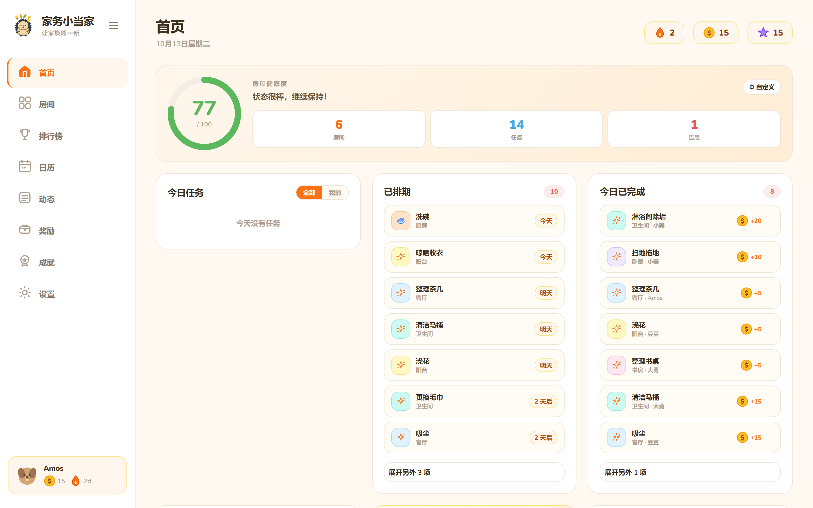
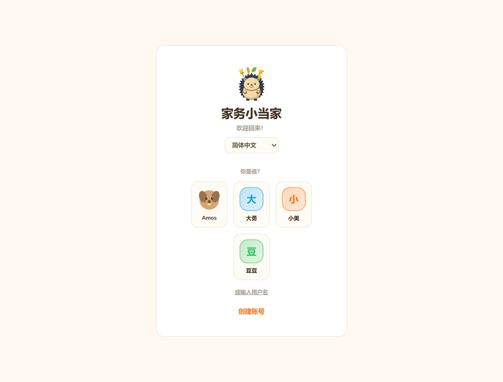
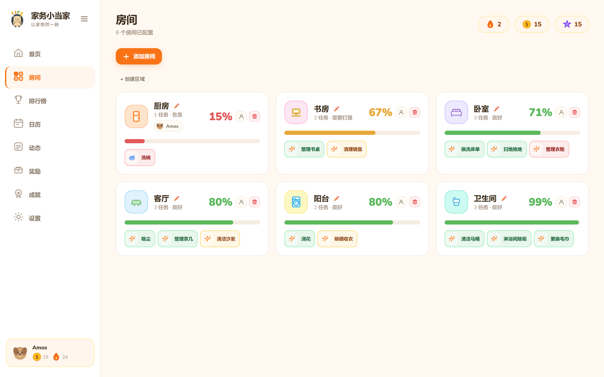
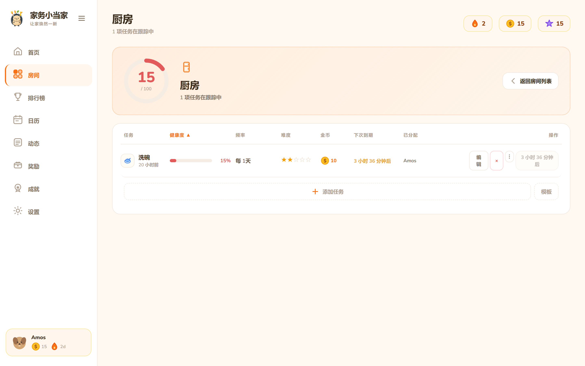
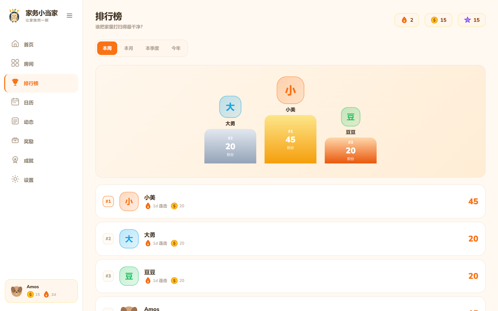
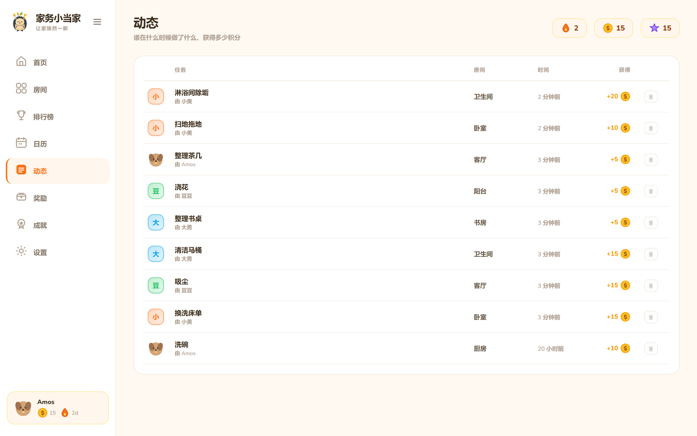
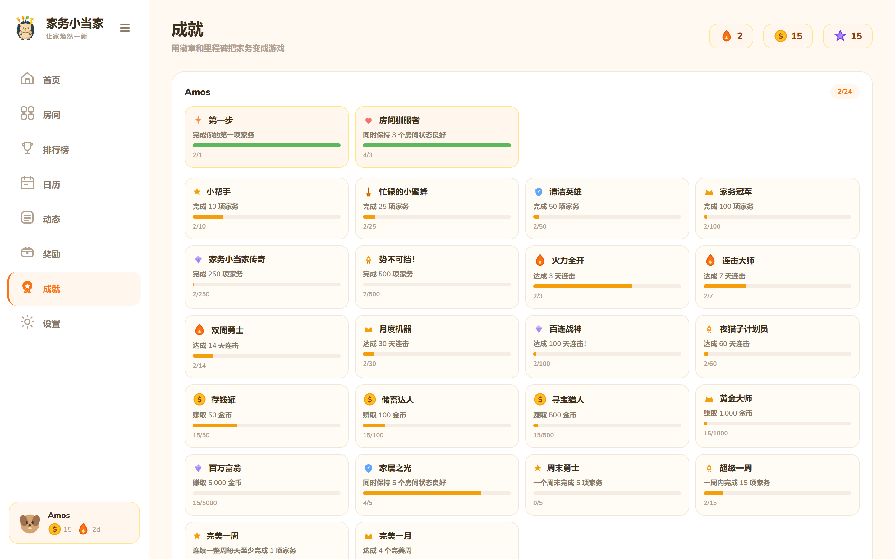
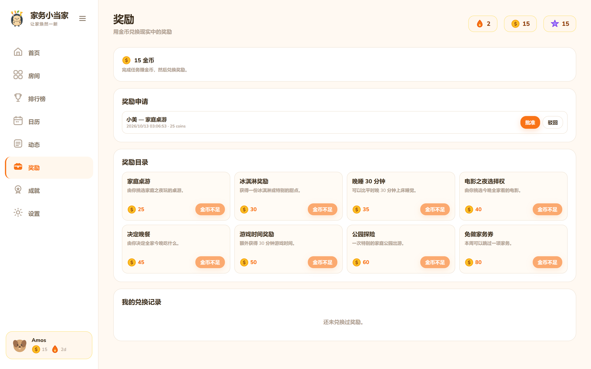
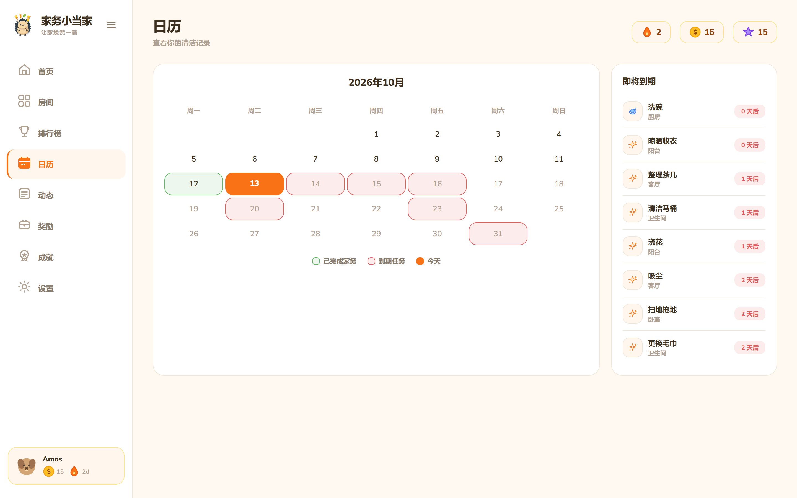
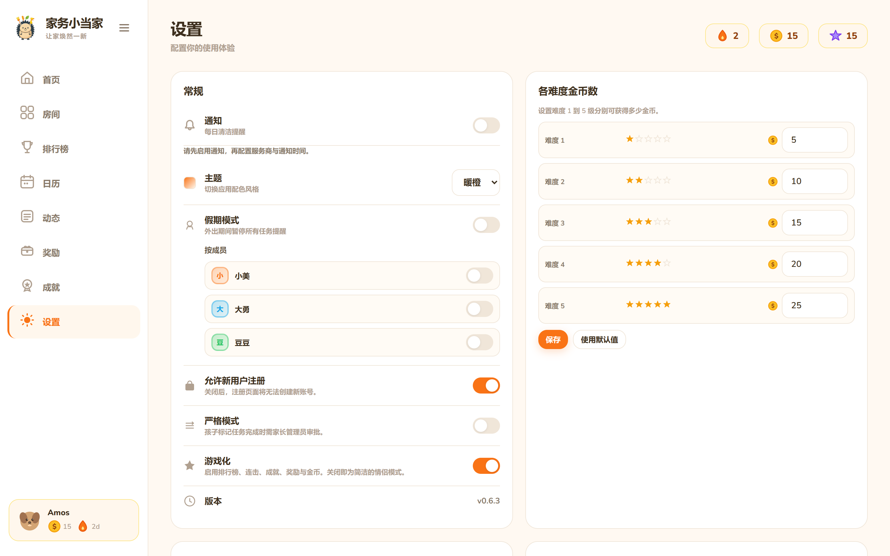

# 🏠 家务小当家

「家务小当家」是个把家务变成冒险的家庭小游戏。每件家务都有「血量」，拖久了会掉血，及时完成就能赚金币、攒连击、解锁成就。家里人各有账号，排行榜上一比高低，孩子抢着干活，大人省心。七日任务、周榜月榜、徽章墙一应俱全，还能用积分兑换奖励。中文界面，自托管部署，数据全在自己手里。

> Transform household chores into an epic family adventure

**家务小当家** is a self-hosted web application that gamifies housework using RPG mechanics. Complete tasks, earn coins, unlock achievements, and compete with your family on the leaderboard.




> 本项目基于 [mellow-fox/TidyQuest](https://github.com/mellow-fox/TidyQuest) 二次开发（AGPL-3.0），在原版基础上完成了品牌汉化、简体中文界面、中文任务库与本地开发体验改造。

---

> [!WARNING]
> **Early-stage project** — 家务小当家 is under active development. You may encounter bugs, incomplete features, or breaking changes between versions. Back up your data regularly and feel free to [open an issue](https://github.com/amuMeta/chore-master/issues) if something breaks.

---

## ✨ What is 家务小当家?

家务小当家 turns boring chores into quests:

- **🎯 血量机制 / Health Bars**: 每件家务有 0–100 血量，按频率线性衰减（频率 N 天的家务每天掉 `100/N` 点），血量见底就是该干活了
- **💰 金币与奖励 / Coins & Rewards**: 完成难度 1–5 的家务赚 5–25 金币，在奖励目录兑换「家庭桌游」「今晚我点菜」等
- **🔥 连击 / Streaks**: 连续完成家务累积连击天数，断掉从头再来
- **🏆 排行榜 / Leaderboard**: 周榜、月榜、季榜、年榜，家里谁最勤快一目了然
- **🎖️ 成就 / Achievements**: 24 枚徽章，覆盖完成数、连击、金币、房间健康四条线
- **📅 日历视图 / Calendar**: 哪些家务快到期，一屏扫完
- **🌍 多语言 / Multilingual**: 简体中文、English、Français、Deutsch、Español、Italiano、Nederlands
- **📱 到期提醒 / Notifications**: 可选 Telegram 或 ntfy 推送

Perfect for families who want to（适合这样的家庭）:
- Make chores fun for kids（让孩子抢着干活）
- Track household responsibilities（谁做了多少，有据可查）
- Encourage teamwork with gamification（用游戏化推动全家参与）
- Build consistent cleaning habits（把打扫变成习惯）

---

## 📸 界面一览

界面全部为简体中文，截图取自真实运行环境（1440×900，2× DPR）。

### 登录 — 家庭成员头像墙，点谁就登谁



### 首页 — 房屋健康度、今日排期、今日已完成、金币与连击


### 房间 — 每个房间一张卡，健康度按颜色分级（绿/橙/红）



### 房间详情 — 任务表：血量条、频率、难度、金币、下次到期、负责人



### 排行榜 — 本周前三登上领奖台，支持周/月/季/年切换



### 动态 — 谁在什么时候做了什么、拿了多少金币



### 成就 — 24 枚徽章墙，进度条实时更新



### 奖励 — 用金币兑换真实现金兑现（家庭桌游、免做一次家务…）



### 日历 — 已完成与到期任务铺在月历上



### 设置 — 通知、主题、假期模式、严格模式、游戏化开关、难度金币表



---

## 🚀 Quick Start

### Prerequisites
- Docker & Docker Compose（或 Node.js 22+，见 Option D）
- 100MB disk space
- Port 3020 available

### Installation

**Choose your deployment method:**

#### Option A: Unraid Community Applications (Easiest)

If you're running Unraid, 家务小当家 is available directly from the **Community Applications** catalog:

1. Open Community Applications in your Unraid dashboard
2. Search for **家务小当家**
3. Click **Install** and fill in your `JWT_SECRET`
4. Done!

#### Option B: Docker Compose — Docker Hub Image (Recommended)

Fastest way to get started on any Linux server using the pre-built multi-platform image:

1. **Create project directory**
   ```bash
   mkdir jiawu && cd jiawu
   ```

2. **Create docker-compose.yml**
   ```yaml
   services:
     jiawu:
       image: mellowfox/jiawu:latest
       container_name: jiawu
       ports:
         - "3020:3000"
       environment:
         - NODE_ENV=production
         - JWT_SECRET=CHANGE_THIS_TO_SECURE_RANDOM_STRING_MIN_32_CHARS
         - TZ=Asia/Shanghai  # 你的时区，影响「今天 / 本周」的边界与通知时间
       volumes:
         - ./data:/app/data
       restart: unless-stopped
   ```

3. **Generate secure JWT_SECRET**
   ```bash
   openssl rand -base64 32
   # Copy output and replace JWT_SECRET in docker-compose.yml
   ```

4. **Launch**
   ```bash
   docker compose up -d
   ```

   Access at **http://localhost:3020**

#### Option C: Build from Source

For development or customization:

1. **Clone the repository**
   ```bash
   git clone https://github.com/amuMeta/chore-master.git
   cd chore-master
   ```

2. **Configure environment**
   ```bash
   cp .env.example .env
   # Edit .env and set a secure JWT_SECRET
   # Generate one: openssl rand -base64 32
   ```

3. **Build and launch**
   ```bash
   docker compose up -d --build
   ```

   Access at **http://localhost:3020**

#### Option D: 本地开发（不用 Docker）

Windows / macOS / Linux 都能跑，环境变量统一放在项目根目录 `.env`，启动时自动加载：

```bash
git clone https://github.com/amuMeta/chore-master.git
cd chore-master
cp .env.example .env        # PowerShell: Copy-Item .env.example .env
# 编辑 .env，把 NODE_ENV 改成 development，并设置 JWT_SECRET
```

然后开两个终端：

```bash
# 终端 1 — 后端 :3000
cd server && npm install && npm run dev

# 终端 2 — 前端 :5173
cd client && npm install && npm run dev
```

浏览器打开 **http://localhost:5173**（Vite 已把 `/api` 代理到 3000，开发时访问 5173 而不是 3000）。

> `.env` 里显式写好的变量会被真实环境变量覆盖，所以 `NODE_ENV=production npm start` 依然可以临时切换生产模式。
> 常用命令（启动/停止/验证/构建）见 [`DEV-COMMANDS.md`](DEV-COMMANDS.md)。

生产模式单端口运行：

```bash
npm run build                                  # 构建前后端
cd server && NODE_ENV=production npm start     # :3000 同时提供 API 和前端静态资源
```

### First Login
On first launch, the database is empty. Create an admin account via the **Register** page.
首次启动数据库为空，在**注册**页面创建的第一个账号会自动成为管理员。

---

## 🎮 Features

### For Everyone
- ✅ **Complete Tasks**: Mark chores as done, earn coins
- 💎 **Redeem Rewards**: Request rewards like "Movie Night Pick" or "Extra Game Time"
- 📊 **Track Progress**: See your current streak, coins, and achievements
- 🏠 **Room Management**: Organize tasks by room (Kitchen, Bedroom, Bathroom, etc.)

### For Admins
- 👥 **User Management**: Create family members (admin/member/child roles)
- 📝 **Task CRUD**: Create, edit, delete tasks with custom frequencies (1-365 days)
- 🎁 **Reward System**: Approve/reject reward requests, manage and customize catalog
- ⚙️ **Global Settings**: Configure coins-per-effort, notifications (Telegram or ntfy)
- 🏖️ **Vacation Mode**: Pause task health decay globally or per member, with individual return dates
- 📤 **Backup/Restore**: Export full database as JSON
- 👤 **Task Assignment**: Assign tasks to specific users with three modes:
  - **First** — first person to complete earns all coins
  - **Shared** — each assignee completes once; coins split equally
  - **Custom** — define a custom coin percentage per assignee (e.g. 70% / 30%)
- ✅ **Strict Mode**: Require admin approval before task completions count
- 💑 **Couple Mode**: Disable gamification (coins, streaks, leaderboard) for simpler tracking
- 🔑 **Password Recovery**: Reset admin password via environment variable

### Built-in Defaults
- **8 Room Types**: Kitchen, Bedroom, Bathroom, Living Room, Office, Garage, Laundry, Garden（厨房、卧室、卫生间、客厅、书房、车库、洗衣房、院子）
- **100+ Predefined Tasks**: 常见家务按房间分组，附建议频率与难度，建房间时可直接勾选
- **8 Preset Rewards**: 家庭桌游、冰淇淋、晚睡 30 分钟、游戏时间、决定晚餐、公园探险、免做家务券、电影之夜
- **24 Achievements**: 完成数、连击天数、金币、房间健康四类里程碑，自动解锁
- **7 Languages**: 简体中文、English、Français、Deutsch、Español、Italiano、Nederlands

---

## 🎯 五分钟上手

1. **注册管理员** — 首次启动数据库为空，在登录页点「创建账号」，第一个注册的账号自动成为管理员
2. **建房间** — 「房间」→「添加房间」，选房间类型（厨房 / 客厅 / 卧室…），从 100+ 预设家务里勾选，也可以自定义。每件家务设**频率**（多少天做一次）和**难度**（1–5 级，决定金币）
3. **加家人** — 「设置」→ 家庭成员，为孩子建账号时角色选 `child`；打开**严格模式**后，孩子完成家务需要家长审批
4. **干活赚币** — 谁完成家务点一下 ✅，金币入账、血量回满、连击 +1；「排行榜」看谁最勤快
5. **兑换奖励** — 「奖励」里用金币申请，管理员批准后生效；驳回会自动退币
6. **出门在外** — 「设置」→ 假期模式（全局或按人），冻结血量衰减与连击，回来接着算

**血量怎么算**：`每天掉 100 ÷ 频率天数` 点。频率 1 天的家务每天掉 100（当天不做就告急），频率 7 天的每天掉 14 左右。房间健康度是房间内所有家务血量的平均值，房屋健康度是全部家务的平均值。

**金币怎么算**：默认难度 1–5 对应 5 / 10 / 15 / 20 / 25 金币，管理员可在「设置」→「各难度金币数」里改，也可以给单件家务设自定义金币。

---

## 🛠️ Tech Stack

| Layer | Technology |
|-------|-----------|
| **Frontend** | React 19 + Vite + TypeScript |
| **Backend** | Node.js + Express + TypeScript |
| **Database** | SQLite3 (with WAL mode) |
| **Auth** | JWT + bcrypt |
| **Deployment** | Docker (single container, ~300MB) |
| **Routing** | React Router v7 |
| **Styling** | Custom design system with CSS custom properties |

**Zero external dependencies** for core functionality. Optional Telegram or ntfy integration for notifications.

---

## 📂 Project Structure

```
chore-master/
├── client/           # React frontend
│   ├── src/
│   │   ├── components/  # UI components
│   │   ├── hooks/       # useAuth, useApi, useTranslation
│   │   ├── i18n/        # 语言文件（en/de/es/fr/it/nl/zh）
│   │   ├── brand.ts     # 品牌单一来源（名称、技术词根、Logo）
│   │   └── App.tsx
│   └── package.json
├── server/           # Express backend
│   ├── src/
│   │   ├── routes/      # API endpoints
│   │   ├── middleware/  # JWT auth
│   │   ├── utils/       # Health calculation, notifications
│   │   ├── brand.ts     # 品牌单一来源（数据库名、成就 id）
│   │   ├── loadEnv.ts   # 启动时加载根目录 .env
│   │   └── database.ts  # SQLite setup
│   └── package.json
├── custom_components/
│   └── tidyquest/    # Home Assistant 自定义集成（Python）
├── data/             # Persistent storage (Docker volume)
│   ├── jiawu.db      # SQLite database
│   └── avatars/      # User-uploaded photos
├── screenshots/      # README 截图
├── Dockerfile        # Multi-stage build
├── docker-compose.yml
├── .env.example      # Configuration template
├── DEV-COMMANDS.md   # 本地开发常用命令速查
├── SECURITY.md       # Security best practices
└── API.md            # API documentation
```

---

## 🔧 Configuration

### Environment Variables

See `.env.example` for all options. Key variables:

| Variable | Required | Description |
|----------|----------|-------------|
| `JWT_SECRET` | **Yes** (prod) | Secret for signing JWT tokens (min 32 chars) |
| `NODE_ENV` | No | `production` or `development` |
| `TZ` | Recommended | Timezone for day/week boundaries & notifications (e.g. `Asia/Shanghai`). Defaults to UTC |
| `PORT` | No | Server port (default: 3000) |
| `ADMIN_RESET_PASSWORD` | No | One-shot admin password recovery. Set, restart, then remove. |

> 项目根目录的 `.env` 会在服务端启动时自动加载（见 `server/src/loadEnv.ts`），所以本地开发不需要在命令行手动传环境变量；同时**真实环境变量优先**，Docker / CI / shell 里显式设置的值不会被 `.env` 覆盖。

### Notifications (Optional)

家务小当家 supports two notification providers (configure in Settings, admin only):

**Telegram**
1. Create a Telegram bot via [@BotFather](https://t.me/botfather)
2. Get your chat ID via [@userinfobot](https://t.me/userinfobot)
3. Enter bot token and chat ID in Settings

**ntfy**
1. Use [ntfy.sh](https://ntfy.sh) or your own ntfy server
2. Enter the server URL and topic in Settings
3. Subscribe to the topic on your phone

Notification types:
- 🕐 **Daily Due Tasks**: Sent at configured time (default 09:00)
- 🎁 **Reward Requests**: Notify admin when child requests reward
- 🎖️ **Achievements**: Celebrate unlocked achievements

---

## 📖 Usage

### Creating Rooms
1. Go to **Rooms** page
2. Click **Add Room**
3. Select room type (e.g., Kitchen)
4. Choose from 60+ default tasks or create custom ones

### Completing Tasks
1. Open a room
2. Click ✅ on a task row
3. Earn coins (5-25 based on effort level 1-5)
4. Health bar resets to 100%

### Redeeming Rewards
1. Go to **Rewards** page
2. Click **Redeem** on a reward (coins deducted immediately)
3. Admin approves/rejects request
4. If rejected, coins are refunded

### Vacation Mode
Admin can enable vacation mode in **Settings**:
- **Global**: Pause health decay for the entire family
- **Per member**: Toggle vacation individually with separate return dates

Vacation freezes task health and protects streaks while members are away.

### Admin Password Recovery

If an admin forgets their password:

1. Add the environment variable to your container:
   ```yaml
   environment:
     - ADMIN_RESET_PASSWORD=your-new-password
   ```
2. Restart the container — the first admin's password is reset
3. **Remove the variable immediately** and restart again

---

## 🔒 Security

**Before exposing publicly**, review `SECURITY.md` for:
- Setting strong JWT_SECRET
- Using HTTPS reverse proxy (Caddy/Nginx)
- Database backup strategy
- Telegram token protection

⚠️ **Never expose 家务小当家 directly to the internet over HTTP**.

---

## 🔄 Updating

### Using Docker Hub Image
```bash
docker compose pull
docker compose up -d
```

### Using Source Build
```bash
cd chore-master
git pull
docker compose down
docker compose up -d --build
```

Your data persists in the `./data` volume.

> 因为本仓库是 fork，拉上游更新需要手动合并：
> ```bash
> git fetch upstream && git merge upstream/main
> ```

---

## 🗄️ Backup & Restore

### Manual Backup (via UI)
Admin → Settings → Export Data → Download JSON

### File System Backup
```bash
cp data/jiawu.db backups/jiawu-$(date +%Y%m%d).db
```

### Restore
Admin → Settings → Import Data → Upload JSON

---

## 🌐 API Documentation

See `API.md` for full endpoint documentation with examples.

Quick overview:
- **Auth**: `/api/auth/register`, `/api/auth/login`
- **Rooms**: `/api/rooms` (CRUD)
- **Tasks**: `/api/rooms/:id/tasks` (CRUD + complete)
- **Dashboard**: `/api/dashboard` (aggregated view)
- **Leaderboard**: `/api/leaderboard?period=week|month|quarter|year`
- **Rewards**: `/api/rewards` (CRUD + redeem)
- **Achievements**: `/api/achievements`

All endpoints require `Authorization: Bearer <token>` (except auth routes).

---

## 🏠 Home Assistant Integration

家务小当家 includes a custom Home Assistant integration that exposes tasks as sensors and allows you to complete or manage them from dashboards and automations.

### Install

1. Copy `custom_components/tidyquest/` into your Home Assistant `config/custom_components/` directory
2. Restart Home Assistant
3. Go to **Settings → Devices & Services → Add Integration** and search for **家务小当家**
4. Enter your 家务小当家 URL and credentials (admin or member account)

### Entities

Each task becomes a `sensor` whose state is the task's current health (0–100). Attributes include `room_name`, `effort`, `is_due`, `assigned_users`, `assignment_mode`, and more.

### Services

| Service | Description |
|---------|-------------|
| `tidyquest.complete_task` | Mark a task as done. HA user is automatically matched to a 家务小当家 user by display name |
| `tidyquest.reset_task` | Reset a task to due/dirty (removes today's completion) |
| `tidyquest.create_task` | Create a new task in a room |
| `tidyquest.update_task` | Update task properties (frequency, effort, etc.) |
| `tidyquest.delete_task` | Delete a task |
| `tidyquest.refresh` | Force immediate sensor refresh |

> HA 集成目录名与 domain 保留为 `tidyquest`（改 domain 会导致已有自动化与实体 ID 全部失效），只有界面显示名改成了「家务小当家」。

### Example — Complete a task from a dashboard button

```yaml
service: tidyquest.complete_task
target:
  entity_id: sensor.kitchen_wash_dishes_health
```

### Example — Automation when a task is overdue

```yaml
automation:
  trigger:
    platform: numeric_state
    entity_id: sensor.kitchen_wash_dishes_health
    below: 20
  action:
    service: notify.mobile_app
    data:
      message: "The dishes need doing!"
```

> **User matching**: HA user names are automatically matched to 家务小当家 `displayName` (case-insensitive). Override with `user_name` or `tidyquest_user_id` in service data.

See `custom_components/tidyquest/README.md` for full documentation.

---

## 🤝 Contributing

Contributions are welcome! Please:
1. Fork the repository
2. Create a feature branch (`git checkout -b feature/amazing-feature`)
3. Commit your changes (`git commit -m 'Add amazing feature'`)
4. Push to the branch (`git push origin feature/amazing-feature`)
5. Open a Pull Request

---

## 📜 License

This project is licensed under the **GNU Affero General Public License v3.0 (AGPL-3.0)**.

**What this means:**
- ✅ You can use, modify, and distribute 家务小当家 freely
- ✅ You can run it commercially (for your business/family)
- ⚠️ If you modify and **host** 家务小当家 as a service (even privately), you **must** share your source code
- ⚠️ Any derivative work must also be licensed under AGPL-3.0

**Why AGPL?** To ensure 家务小当家 remains free and open-source forever, preventing proprietary SaaS forks.

See the `LICENSE` file for full details.

---

## 🙏 Acknowledgments

- 原始项目：[**mellow-fox/TidyQuest**](https://github.com/mellow-fox/TidyQuest)（AGPL-3.0），本项目在其基础上做了品牌汉化与中文本地化改造
- Inspired by RPG mechanics from classic games
- Built with love for families who want to make chores fun
- Uses [Nunito](https://fonts.google.com/specimen/Nunito) font (bundled locally)

---

## 📞 Support

- 🐛 **Bug Reports**: [GitHub Issues](https://github.com/amuMeta/chore-master/issues)
- 🔒 **Security Issues**: See `SECURITY.md` for responsible disclosure

---

Made with ❤️ for families everywhere
